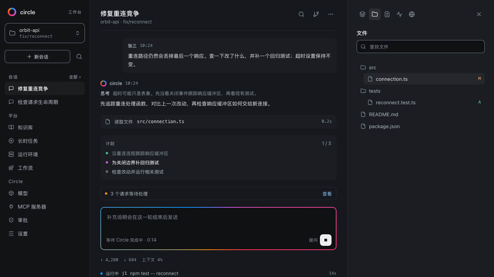
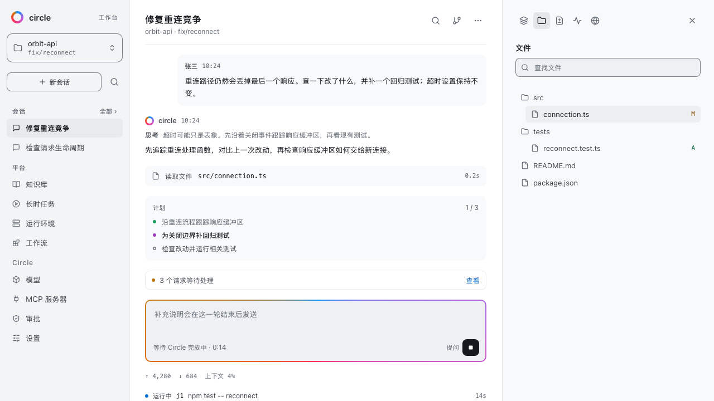
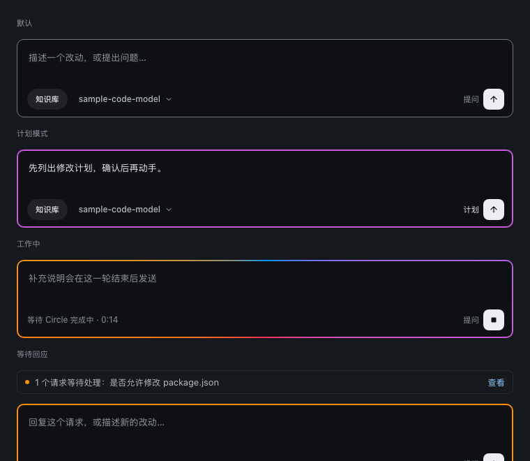
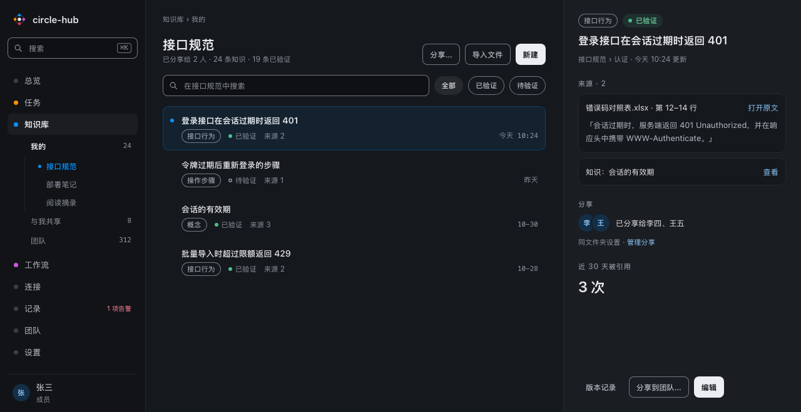
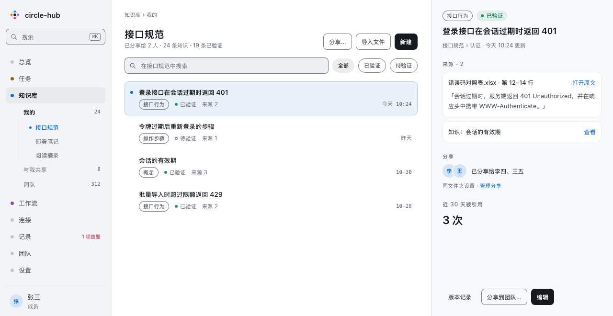
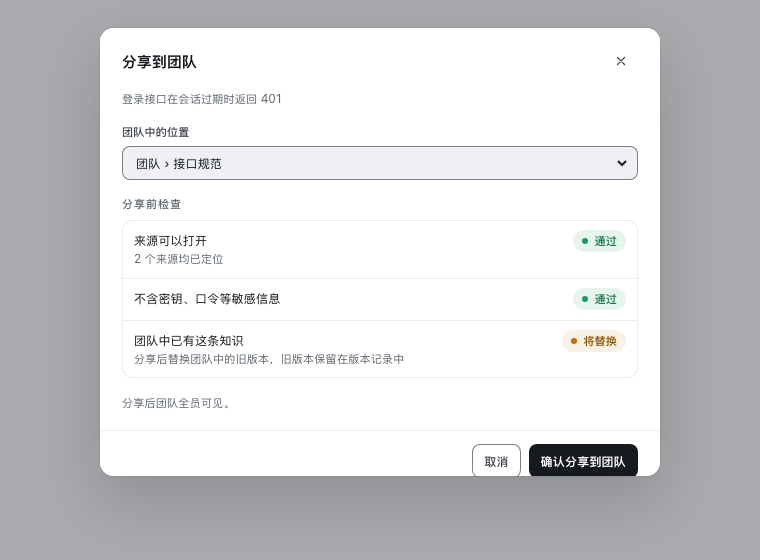
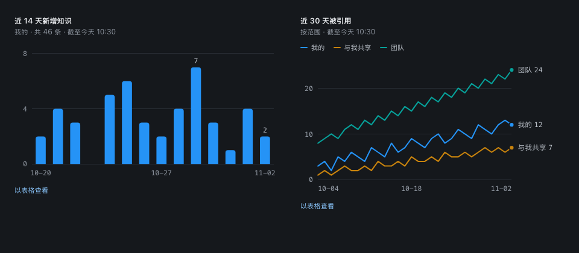

# 效果图

这些图是《Circle 设计规范》的组件预览在两套主题下的渲染结果：组件预览在 `circle-design-system/components/<组件>/preview.html`，样式来自 `circle-design-system/tokens.json` 生成的设定与 `circle-design-system/components/bundle.css`。图中只有合成数据。

规范正文见 [circle-design-system/README.md](circle-design-system/README.md)。

## Circle 工作台

导航、会话与抽屉三栏，深色：

同一画面，浅色：

输入区的四种状态：默认、计划模式、工作中、等待回应：

## circle-hub 控制台

知识库页面，导航、列表与详情三栏，深色：

同一页面，浅色：

分享到团队前的检查：

## 图表与封面

单系列柱状图与多系列折线图：

规范封面：

