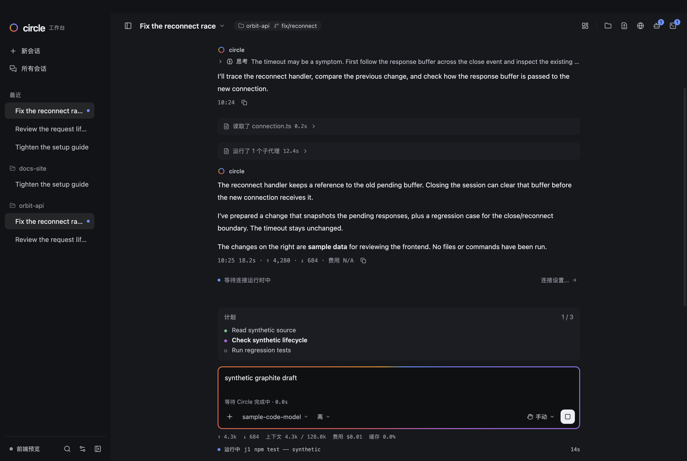
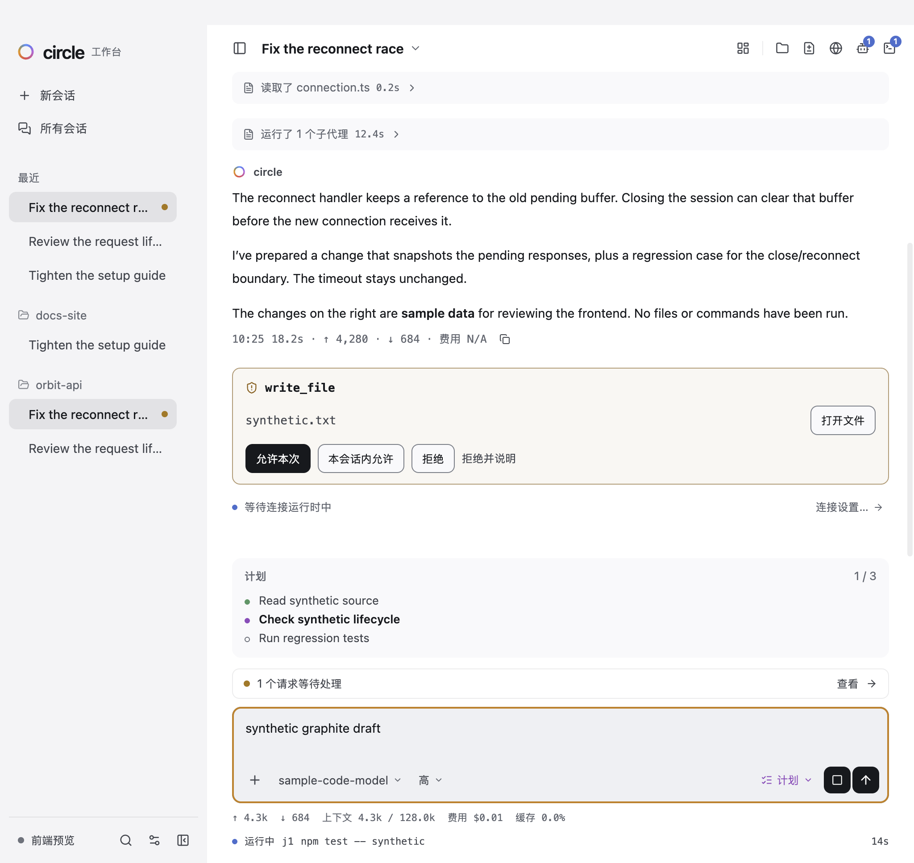

# Graphite 桌面验收记录

2026-11-03（Asia/Tokyo），decision 93。本轮源码冻结于 `fa905204ff48029eb65c9523edfcce77b40e1d61`；中文审查跟进为 `89ae2b98`。本页记录 macOS arm64 本机开发入口和本地打包应用的实际检查，最终视觉批准由 Claude 审查。

本页的证据采集于变基之前：源码提交 `fa905204`，基线 `8b9c1736`。分支随后变基到 `main` 的 `887849a0`，新增的上游改动是 #399 的本地技能工具（核心 `src/` 下 6 个文件，不涉及 `apps/`）以及两份设计规范文档。原生矩阵没有在变基后重跑；PR 的检查会在变基后的代码上重新运行。收据中的源码摘要对应变基前的文件。

所有流程使用临时 `CIRCLE_HOME`、`CIRCLE_WORKBENCH_DATA_DIR`、合成工作区和脚本模型或 loopback 网关，没有使用真实 Circle 数据、付费模型或生产设备。终端的 `DEFAULT_DARK` / `DEFAULT_LIGHT` 未变，CLI 保持英文。按 Claude 对设计 README 的修正，中文与拉丁字母、数字、占位符之间保留一个空格；主动执行用“正在”，等待他人、排队、回应、重启和重试用“等待”。词典回归同时检查这两条规则。

## 检查结果

下列组有重叠，不相加。重型检查按顺序运行。退出码、逐项跳过及摘要见 [checks.json](validation/graphite/checks.json) 和 [native-runs.json](validation/graphite/native-runs.json)。后者保留历史失败及后续修正后的完整执行，不把失败或未开始项记成通过。

| 命令 / 检查                                                                               | 实际结果                                                                                                                                                                            |
| ----------------------------------------------------------------------------------------- | ----------------------------------------------------------------------------------------------------------------------------------------------------------------------------------- |
| `npm run check`                                                                           | 退出 0；1,584 项中通过 1,574、失败 0、跳过 10；类型检查和核心构建通过                                                                                                               |
| `npm run check:apps`                                                                      | 退出 0；workbench 337、desktop 单元 163 全部通过；runtime 821 项中通过 804、失败 0、跳过 17；两应用类型检查和构建通过                                                               |
| 核心、workbench、desktop 的 `format:check`                                                | 三组均退出 0                                                                                                                                                                        |
| 受影响组件组                                                                              | 11 个不同专项通过：editor、GitHub 授权阶段/连接/插件/侧栏、original-browser-shell、overview-cards、terminal-mode、browser-chrome、overview-actions、workspace-shell；不是完整组件组 |
| 开发版 `test:desktop`                                                                     | 完整命令退出 0；宿主 23 检查，含浏览器专项、终端、GPU 开/关弹窗、两种协议的模式工具配对；配对各有 5 次实际请求                                                                      |
| 开发版 `test:interface` / 窄窗界面                                                        | 均退出 0，各 47 命令、87 检查、无页面错误；1024px 宿主另有 23 检查通过                                                                                                              |
| 开发版完整 `test:live` / `test:compaction`                                                | 均退出 0；live 完成全部 15 个脚本路径，核心 25 检查；压缩 6 检查；tray 跳过见下文                                                                                                   |
| 打包版上述六组原生命令                                                                    | 全部退出 0，回执 `packaged:true`；宽窄界面各 47/87，宽窄宿主各 23，live 核心 25、压缩 6；保留下列原有跳过                                                                           |
| 最后单独执行 `node node_modules/tsx/dist/cli.mjs --test tests/browser-pipe-close.test.ts` | 退出 0；1 项通过、失败/跳过 0，约 1 秒；未改原 2 秒超时                                                                                                                             |

核心 10 项和 runtime 17 项跳过均为原有 Windows 条件，名称及原因已与前块日志逐项比较一致；完整清单在 checks.json。第一块 Browser.getVersion 的失败仍记录为 Claude 已复核的负载相关超时（当时负载约 11、三名 agent 同时测试，受测代码自 `f672b668` 未变）；最后单独通过不覆盖原失败。

打包 `test:desktop` 保留五个既有跳过，guard 未改：

- `browser-page.mjs`、`browser-lifecycle.mjs`：原脚本只运行开发 Electron；打包 browser-live 独立执行，不等同于这两个用例通过。
- `browser-key-race-native.mjs`：原打包分支跳过，说明指向 popout；不把说明当作本用例通过。
- `terminal-panel.mjs`、`popout.mjs`：原 `CIRCLE_DESKTOP_EXECUTABLE` 分支跳过。日志的“needs a desktop-capable session”并不表示本次没有桌面。打包 popout-press-native 实际执行，但不等同于完整 GPU 双模式 popout 用例。

这五项在完整开发版中实际执行通过。macOS tray 在开发与打包 live 中均按原条件跳过：Dock 保持显示，托盘不隐藏窗口。所有跳过与通过分开记录。

## 四轮原生矩阵

每轮为 dark/light × 1440/1024px × default/plan/working/attention：16 个样本、13 组检查、20 张截图、`errors:[]`。共 64 个样本和 80 张本机原图，选取 11 张原样保存在 Git；其余图像的文件名和 SHA-256 仍在收据中，本机位置由 `localEvidenceDirectory` 给出。

| 入口 / 语言  | 收据                                                              |
| ------------ | ----------------------------------------------------------------- |
| 开发 / zh-CN | [development-zh](validation/graphite/development-zh-receipt.json) |
| 开发 / en    | [development-en](validation/graphite/development-en-receipt.json) |
| 打包 / zh-CN | [packaged-zh](validation/graphite/packaged-zh-receipt.json)       |
| 打包 / en    | [packaged-en](validation/graphite/packaged-en-receipt.json)       |

实际 Electron 44.9.1、Chromium 152.0.7977.167、应用 Node 24.22.0，runner Node 24.22.1。申请 980px 高度受到屏幕可用区约束；实际样本高度为 965 或 967px，各样本记录自己的 viewport，未声称实际为 980px。

检查覆盖三层表面、232px 导航、380px 抽屉、760px 内容上限、1180/1179px 抽屉分界、700px 导航入口、四态操作、答复/停止/继续/Enter 插话和草稿保存、1024×650 长草稿、auto 跟随、减少动态效果、长路径/模型菜单、原始工具详情，以及连续切换菜单的焦点。状态点和状态文字分别取色。浅色品牌边框对外层 surface-1 的实测对比度：蓝色 3.14:1、橙色 3.12:1；状态另有文字，按 Claude 决定保留 token。

已打开检查开发及打包代表截图，包括中文深色工作中、浅色计划/待回应、英文窄窗工作中、抽屉和工具详情。人工查看不代替 Claude 的最终视觉批准。界面预览截图中的合成对话、工具原文和模型标识保持原值；实际运行时效果由独立 live / compaction 流程验证。





| 场景                         | 开发版                                                           | 打包版                                                                                                                                                                                             |
| ---------------------------- | ---------------------------------------------------------------- | -------------------------------------------------------------------------------------------------------------------------------------------------------------------------------------------------- |
| 深色窄窗默认态               | [截图](validation/graphite/development-dark-1024-default.png)    | [截图](validation/graphite/packaged-dark-1024-default.png)                                                                                                                                         |
| 浅色计划态                   | [截图](validation/graphite/development-light-1440-plan.png)      | [截图](validation/graphite/packaged-light-1440-plan.png)                                                                                                                                           |
| 深色工作中                   | [截图](validation/graphite/development-dark-1440-working.png)    | 上图                                                                                                                                                                                               |
| 浅色待回应                   | [截图](validation/graphite/development-light-1024-attention.png) | 上图                                                                                                                                                                                               |
| 展开抽屉 / 长标识 / 工具详情 | —                                                                | [抽屉](validation/graphite/packaged-dark-1440-drawer.png)、[长标识](validation/graphite/packaged-light-1024-long-labels.png)、[工具详情](validation/graphite/packaged-light-1440-tool-details.png) |

## 检查发现与修正

- CV-1：按钮 DOMRect 为 26.000015px。改为计算样式精确检查 26px/26px/6px，实际宽高误差仍必须小于 0.001px，不延长等待或重试。
- CV-2：React 门户菜单的 Escape 冒泡关闭抽屉。面板只处理自己 DOM 内且未被消费的事件，并检查关闭菜单后抽屉仍在。
- CV-3：旧 files/terminal/browser 选择器覆盖抽屉颜色。补齐 `.inspector.work-drawer` 优先级，实际表面检查要求 surface-2。
- CV-4：1024px 窗口中的长模型 ID 菜单约 2792px 宽。限制菜单宽度、省略单行显示，title 和运行时仍保留完整 ID；实际选择另一模型通过。
- CV-5：旧菜单退出回调抢走新项目菜单的焦点。已有另一菜单/对话框打开时不回焦；同一步骤的修正前后原生观察及永久回归保留。

旧界面断言同步批准后的品牌、请求按钮名称、表面与 1180px 分界；退出动效等待真实卸载，几何检查在原有 40 帧限额内检查 x/y/宽/高。压缩流程只允许输入区新增的至多一个 elapsed-only 时钟，不允许第二份状态或 token 文本，原有取消/恢复及对齐检查保留。新工具详情场景还发现两处预览文字未接翻译，已补 `t()`。没有增加重试或超时求绿；完整诊断保留在本机忽略的 graphite artifacts 中。

## 打包字节与复核

`npm --prefix apps/desktop run package` 使用隔离输出目录 `apps/desktop/out/graphite`，退出 0，生成 `Circle-darwin-arm64/Circle.app` 与 `circle-desktop-1.14.0-darwin-arm64.dmg`。本地 ad hoc 签名及最终严格 codesign 校验通过；没有公证、安装到 Applications、发布或推送。构建保留既有大 chunk、CJS import.meta、缺少 .icon 格式及 hdiutil 弃用提示；无 hdiutil 重试。

四轮共享的 [源码/构建清单](validation/graphite/source-build-manifest.json) 含 1,064 个源码、2,612 个构建和 4 个设计文件。逐项重算与全部 80 张图像的摘要不一致均为 0。每份矩阵收据引用该清单摘要；打包收据还记录实际 ASAR 摘要。

[打包原始收据](validation/graphite/artifact-receipt.json) 与 [最终完整性检查](validation/graphite/package-integrity.json) 记录 2,571 个产物哈希一致，并从实际 ASAR 提取 2,612 个 dist 文件与本次构建逐项比较，不一致 0；原生流程结束后再次校验。DMG SHA-256：`3ae48fc4aeb0e8831a3df62fbb53de4c00357d33aea9597d96781d2d1ce1503f`；ASAR：`2b93a6dbd780b9b1d100063a2159a5dc8b4e8a854e79d953d2d2f8bc3250a845`。

复现矩阵时从仓库根运行；脚本自己创建临时 home/data/project，切换两主题、两宽度和四态。语言分别设为 `zh-CN`、`en`，输出目录分别保存；打包入口额外设置下面两个变量（开发版不设）：

```sh
export CIRCLE_DESKTOP_APP_PATH="$PWD/apps/desktop/out/graphite/Circle-darwin-arm64/Circle.app"
export CIRCLE_DESKTOP_EXECUTABLE="$CIRCLE_DESKTOP_APP_PATH/Contents/MacOS/Circle"
CIRCLE_WORKBENCH_LANGUAGE=zh-CN \
  CIRCLE_GRAPHITE_EVIDENCE_DIR=apps/desktop/artifacts/graphite/review-packaged-zh \
  node apps/desktop/test/graphite-native.mjs
```

其余原生命令为 `test:desktop`、`test:interface`、`test:live`、`test:compaction`（均在 desktop 包运行）；用 scratch `CIRCLE_HOME` / `CIRCLE_WORKBENCH_DATA_DIR`。窄窗主流程直接运行 `apps/desktop/test/desktop.mjs` 和 `interface.mjs`，设置 `CIRCLE_DESKTOP_CHECK_NARROW=1`。这些本机合成检查不建立真实模型服务、生产设备或其他操作系统的兼容结论。
